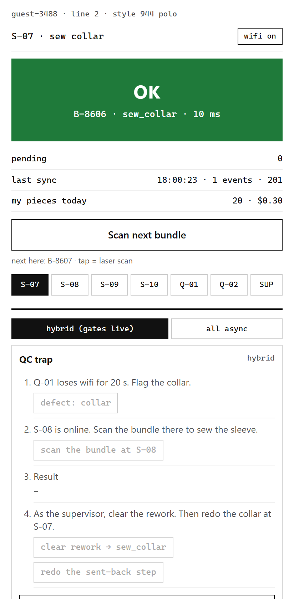
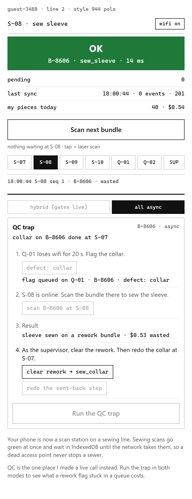
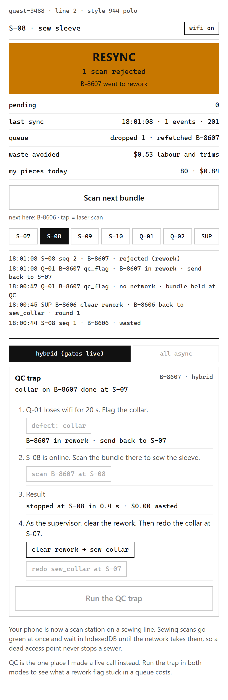
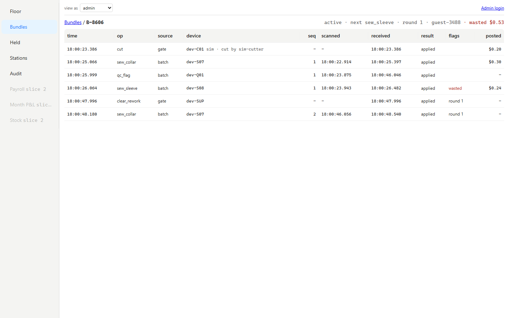

I built Factory Floor to show how I track garment bundles through a sewing line when the floor's Wi-Fi can't be trusted. Your phone becomes a scan station on a working line, and you can watch a bad bundle get sewn under one design and stopped under the other.

It is live at https://factory.tahmidalavi.com. `/admin` is read-only unless I sign in, and `/hood` streams what the API and the worker are doing.

It is rebuilt from scratch from a system I shipped, which is under NDA, so nothing here names the factory or its numbers.




## The hardest decision

A bundle is about 50 cut pieces, and it passes 20 to 40 sewing operations. Operators are paid per piece, so a scan that waits on the network costs them money and stalls the line. The factory Wi-Fi was bad: overlapping access points, a lot of metal, devices roaming between them all day. We tried persistent sockets first (MQTT, then WebSockets). They kept dropping, drained the scanners' batteries by lunch and leaked memory on the devices, so we took them out.

So scans went offline-first. Each scan was written to a local table on the device and showed green in a few milliseconds. A background job sent pending scans in batches over plain HTTP when the network was up, and backed off when it wasn't. The API checked timestamps so a late batch could not overwrite newer state, then handed events to RabbitMQ, and workers updated Postgres.

That broke at QC. An inspector flags a bundle for rework, but the flag is still sitting in the inspector's local queue. Someone carries the bundle back to sewing, the next operator scans it, their device has never heard of the defect and accepts it, and a sleeve gets sewn onto a garment that is already ruined.

The fix was a hybrid. Most of the floor stayed offline-first. The stations where a bundle's state really matters (the QC flag, end-of-line QC, cutting, shipping) became gates: a scan there makes a blocking call to the server, and a rework status or a timeout locks the screen red. The bundle cannot move until the server has answered.

This demo runs the same scenario both ways, on your phone, and counts the wasted money.


## Try the trap

Open the site on a phone. You get three bundles of your own at S-07 (sew collar) and a card that runs the QC trap. Pick a mode, then:

1. Your phone becomes Q-01, inline QC, and its Wi-Fi drops for 20 s. You flag the collar on your bundle.
2. Your phone becomes S-08, sew sleeve, with Wi-Fi up. You scan the same bundle.
3. The supervisor clears the rework back to sew collar.

In all async, QC's flag waits in QC's queue, S-08's scan reaches the server first and is applied, and the flag lands after it. The card says `sleeve sewn on a rework bundle · $0.53 wasted`: 20 pieces at the sleeve rate of $0.012, plus $0.29 of trims.

In hybrid, the flag is a gate call, so with Wi-Fi down it fails and the bundle stays held at QC; step 2 does not unlock until the flag has reached the server. S-08 still shows green for a moment, because it is offline-first too. Its batch syncs, the server rejects the scan, and the station turns amber with `RESYNC · 1 scan rejected`. The card says `$0.00 wasted` and how long it took from S-08's green to the resync.

Either way the redone collar is paid $0.00. If rework were paid, operators would fail QC on purpose to double their wages.

 

Both runs above are from the live deploy on 10 Nov 2026.

The Wi-Fi switch on the station works outside the trap too. Scans keep going green, the pending count grows, the next retry counts down, and the queue drains when you switch it back.


## Two paths into one database

```
phone station (IndexedDB queue) ── POST /scans/batch ──▶ Caddy ─▶ api ─┬─ Postgres
                                 ── POST /gate/scan  ──▶              ├─ RabbitMQ ─▶ worker ─▶ Postgres
admin (polls), /hood (SSE)       ── GET ──────────────▶              │
simulated line (in the worker)   ── the same HTTP as a phone ─────────┘
```

The batch path is the offline one. A scan is a row in the browser's IndexedDB with a device id and a sequence number. The sync loop waits 300 ms after the last scan, then sends up to 50 events. On failure it retries after 1, 2, 4, 8, 16 and then 30 s, with 20% jitter, and it also syncs every 10 s even when nothing is pending, so the station hears about bundles that changed under it.

- The API writes each event into an inbox table and publishes it to RabbitMQ after the commit. `(deviceId, seq)` is unique, so a retried batch is a no-op.
- The inbox is also the outbox. If the publish is lost, a sweep every 30 s republishes anything the worker has not applied yet, and the worker's apply is idempotent, so a double publish does nothing. On a whiteboard: write first, publish after, sweep what didn't get applied.
- An event is accepted only if its scan time is between 24 h ago and 1 minute ahead, after correcting the device clock, and never before the device registered. The clock offset is the server's time minus the midpoint of the request.
- The worker takes the bundle row with `SELECT ... FOR UPDATE` and runs a strict state machine. The bundle's next step is applied. A step already done this round is a duplicate. A later step is held, and held steps are released in route order once the missing one arrives. Anything on a bundle in rework is rejected.
- The reply to every batch lists each event's result, plus a `resync` entry for each bundle that has gone to rework or scrap. The station drops its queued scans for those bundles instead of retrying them forever. That is the poisoned-queue reply, and it is how S-08 finds out in hybrid.

The gate path is one transaction: lock the bundle, apply or refuse, reply. The station gives it 2 s. A rework status or a timeout is a red STOP, and the scan is never queued. The server's own budget for the lock and the transaction is under that, so a slow gate fails on the server before the station gives up.

Both paths lock the same bundle rows, which is why the worker locks too.

Only a supervisor can clear rework, and the clear is a gate call written to the audit log. The bundle's route rolls back to the operation that caused the defect and its rework round goes up by one, so the redone steps are not duplicates. A redone step gets no labour posting. Any batch event older than the clear is rejected as stale.

There is no socket anywhere. Stations use HTTP, the admin polls, and `/hood` is server-sent events. Sockets are what failed on the real floor.

RabbitMQ is not needed for this demo's volume. It is here because the real system had it, and because it keeps ingest fast while the apply path waits on row locks.


## Money

Money is integer mills (a thousandth of a dollar). Every cost and every sale is a row in one postings table, with a kind (fabric, trims, labour, revenue, adjustment, write-off) and the month it belongs to. The P&L is a `GROUP BY` over that table, in SQL, and the month-end close stores the same query's answer, so the closed number and the live number come out of one function.

### Fabric

Fabric comes in rolls of 300 m, bought at $3.20 to $3.60 a metre, and a bundle takes 18 m. Every metre in or out is a row in a stock ledger: received, issued to cutting, or adjusted after a count. The ledger is append-only. The app's database role can't update a movement, and a trigger refuses a delete unless the row belongs to a test roll. A roll's on-hand is the sum of its movements, never a stored balance.

A cut locks the roll row, sums its ledger, and issues 18 m if it's there. That lock is the whole of the concurrency story: two cutting tables can't both take the last 18 m. If a cut would leave less than a bundle, it takes the rest of the roll, because nobody cuts a bundle out of 9 m of remnant. The issue posts a fabric cost at that roll's price, so two bundles cut from different rolls can cost different amounts.

The stock page has a stress button. It receives a 100 m test roll and fires 20 cuts of 10 m at it at once, each in its own transaction, the way 20 cutting tables would. Ten get through and ten are refused, every time, and `/hood` prints how long it took. Test rolls carry no money and are purged after an hour.

### What gets posted when

- Cut: fabric, at the roll's price.
- Each sewing step: labour at the piece rate in force at the scan time, plus that operation's trims.
- Ship: revenue, at the FOB price ($4.20 a piece) times the bundle's pieces.
- Scrap: a write-off of everything already spent on the bundle.
- A stock count that disagrees with the ledger: an adjustment at the roll's price, a loss as a cost and a find as a negative cost.

The P&L is on an incurred basis. Fabric and labour are costs in the month they're spent, and revenue lands in the month the bundle ships, so a month with a lot on the line looks worse than it is. Two memo lines say how much: work in progress (what has been spent on bundles still on the line when the month ended) and write-off (what was spent on bundles that were scrapped). Neither is subtracted again, since those costs are already in.

### Waste and the audit log

Applying a step writes a labour posting at the piece rate in force at the scan time; rates carry an `effectiveFrom` date. Waste is priced from those postings: when a rework flag lands, every step applied after the flag's scan time is marked wasted, and its labour plus that operation's trims is the waste. One function does that, for the trap card and for the admin.



The timeline shows why: the flag's scan time is before the sleeve's, even though it reached the server 20 s later, so the sleeve is the wasted step.

The audit table can be inserted into and read by the app's database role, and that's all. UPDATE and DELETE are revoked in a migration, and a test proves an UPDATE fails. Migrations run as a second role.

### Closing a month

A closed month can't change. Every posting takes a shared advisory lock on its month before it checks whether that month is closed, and the close takes the same lock exclusively. So a close waits for postings already running, and postings that arrive during the close wait for it and then see it closed. The close runs at five past each hour for the month before, and the admin can run it by hand.

A scan that is dated in a closed month still counts. Offline-first means a device can come back on the 2nd with scans from the 31st. Its postings keep their own date but are booked into the earliest open month, and the P&L shows them as their own line: `late scans from October`. October's closed number never moves.

### The seeded month

The live line only started in November, so to have a closed month to show I ran October through the same code. The seed runs the simulator, the API and the worker in one process on a fixed clock, from 1 Oct 00:00 UTC to the minute it started, then closes October at 1 Nov 00:05 as `seed`.

It runs slower than the live line: about 165 bundles a day against about 1,200 live, because a full-pace month would have taken hours on this VM and the API is down while it runs. Each tick moves the clock 5 minutes and spreads its scans across those 5 minutes. The two hours around midnight on the 31st run finer, at 30 s ticks.

That's where the late scans come from. The seed takes S-09 offline from 23:50 on 31 Oct to 00:20 on 1 Nov. Its scans queue on the device, and S-10's scans on the same bundles are held until S-09's arrive. When S-09 comes back, after the close, all of them are booked into November as late scans from October: 20 postings on the live run. That is S-09's outage and everything that waited on it, not 20 of S-09's own scans.

On the live VM on 11 Nov 2026 it made 6,871 bundles and 60,757 postings in 23 minutes. October closed in 56 ms with $77,893.74 of contribution and $12,463.90 of work in progress. The API was down for 24 minutes.

The money pages are `/admin/stock`, `/admin/payroll` and `/admin/pnl`. The P&L can leave out the simulated line's rows, which leaves only what visitors did.


## Measured on the live deploy

From the last 200 lines of `/hood` on 10 Nov 2026, about five minutes of the simulated line. Server-side only; the phone's network time is not in these.

| | median | max |
| --- | --- | --- |
| batch ingest (inbox write, 1 event) | 6 ms | 15 ms |
| worker apply, waiting for the bundle lock | 1 ms | 7 ms |
| worker apply, whole transaction | 14 ms | 84 ms |
| gate call | 10 ms | 20 ms |


## The simulated line

The line runs whether or not anyone is visiting, so the admin always has something on it. The simulator lives in the worker process and calls the same public HTTP endpoints a phone does, with its own devices, so its numbers come out of the same code. Its rows are marked simulated everywhere they appear.

It sends a key header, and the API only believes it from loopback or from the worker container's own address, never with an `X-Forwarded-For` header, so the key alone is not enough from outside. `/sim/*` answers 404 through Caddy anyway.

It keeps off your bundles while you're using them. While you're active it may only carry your packed bundles, or ones past the stations you can reach, on to the end of the line. Five minutes after you go quiet, your bundles are treated like any other.


## Running it locally

Docker for Postgres 16 and RabbitMQ, and Node 22.

    cp .env.example .env
    docker compose up -d

Fill in `.env` first. Postgres is published on `127.0.0.1:5440` and has two roles, `ff_owner` for migrations and `ff_app` for the app, and two databases, `factory` and `factory_test`. So `DATABASE_URL` is `postgresql://ff_app:<FF_APP_PASSWORD>@127.0.0.1:5440/factory`, `OWNER_DATABASE_URL` is the same with `ff_owner`, and the two `TEST_` URLs point at `factory_test`. RabbitMQ is on `127.0.0.1:5680`. Then:

    cd api && npm ci && npm run migrate && npm run seed
    npm run start:dev                       # API on 4120
    npm run build && npm run start:worker   # worker and simulated line, second terminal
    cd web && npm ci && npm run dev         # station on http://localhost:3140

Set `SIM_ENABLED=0` in `.env` for a quiet line.

### Tests

    cd api && npm test                      # unit, 67
    npm run migrate:test && npm run test:e2e   # against factory_test and RabbitMQ, 192
    cd web && npx playwright install chromium && npx playwright test   # phone browser and admin, 29

Playwright builds and starts its own API and worker on `factory_test` with the simulated line off, and shortens the trap's Wi-Fi drop to 3 s. `npx playwright test -c playwright.sim.config.ts` runs the trap in both modes again with the line running fast beside it, which is how I found the simulator touching a visitor's bundle.


## Deploy

The web app is on Vercel (`factory.tahmidalavi.com`, root `web`, `NEXT_PUBLIC_API_URL` set to the API). The API, worker, Postgres and RabbitMQ run on one small Arm VM behind the shared Caddy from my `demo-host` repo, at `factory-api.tahmidalavi.com`. The API is published on `127.0.0.1:4201` only, and the worker has a fixed address on the compose network so the API can tell it apart from Caddy.

Files: `deploy/docker-compose.prod.yml`, `deploy/deploy.sh`, `deploy/env.prod.example`, `deploy/smoke.mjs`. `deploy.sh` refuses to run with an empty secret, migrates and seeds with the new image while the old API is still serving, then swaps the API and worker. The memory ceilings, in MB: Postgres 384, RabbitMQ 256, API 256, worker 192. RabbitMQ's memory alarm is set at 200 MB, because its idle footprint in that image is about 160 MB and a lower setting blocks every publisher from boot.

    node deploy/smoke.mjs https://factory.tahmidalavi.com https://factory-api.tahmidalavi.com

It makes one guest, runs a batch round trip and a gate flag with its rejected follow-up, and checks that `/sim/work` is 404 from outside and which pages may be framed.

The smoke test also checks that October is closed, runs the roll stress once and reads today's payroll. The stress button allows one run a minute per address, so wait a minute between smoke runs.

`deploy/reseed.sh` is the one-off that wiped the slice-1 data and seeded October. It does nothing without `--yes`.

The Caddyfile is mounted into its container as a single file, so after a `git pull` in `demo-host` Caddy has to be restarted, not reloaded. A reload reads the old file and says the config is unchanged.


## Known limits

- One VM, one Postgres, one RabbitMQ, one worker, one API process. No failover.
- The station is a browser page, not the rugged Android app. IndexedDB and a JavaScript sync loop stand in for the local database and the background job, and sync stops when the tab is closed. The real app kept syncing.
- Hybrid narrows the stale window; it does not close it. A downstream station that is itself offline still accepts a rework bundle locally until it syncs. On a real floor the physical gate covers that: the bundle doesn't leave QC until it's cleared.
- Device clocks are corrected by a measured offset, not trusted. A device whose clock jumps between two syncs can still misorder scans inside that window.
- Rate limits live in the memory of the one API process, so a restart resets them, and a second replica would need them in a shared store.
- Visitor numbers are small and most of the activity is the simulated line, labelled as such.
- Scanning is by tap. Camera scanning of a printed ticket comes with the Android app.
- The P&L is incurred, not accrual. Revenue and the cost of the same bundle can fall in different months; the work-in-progress line says by how much.
- Admin reset removes this month's guest and simulated postings with their bundles, but the stock ledger is append-only and keeps the fabric those bundles took. After a reset, issued fabric and fabric postings no longer match.
- A visitor's bundles go 24 h after they go quiet, and their postings with them, so the work-in-progress line understates what visitors left on the line.
- The simulated line's scans are kept for 60 days, and payroll is read from scans, so October's payroll page goes empty at the end of November. Its postings stay, so October's P&L and its close don't change.
- The day of the reseed has a hole of 24 minutes with no scans, from when the seed started until the live line came back. It shows in that day's floor and payroll.
- The seeded October runs at a slower pace than the live line (see Money). Its totals are real sums of real postings, but there are fewer of them.
